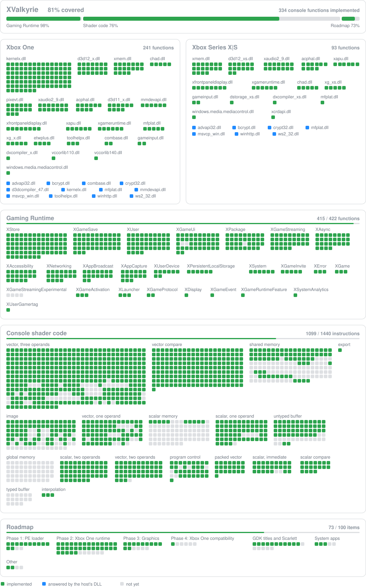

# XValkyrie

[](https://github.com/sammwyy/xscarlet/actions/workflows/build.yml)
[](LICENSE)

XValkyrie runs Xbox One and Xbox Series X|S software on 64-bit Windows. It is written in
C++20.

It is a translation layer, not an emulator. Both consoles are x86-64 machines that run a
cut-down Windows, so there is no CPU to emulate and no system to boot: a title's executable is
mapped into a process, its code runs natively, and the console libraries it imports
(`d3d12_xs.dll`, `xgameruntime.dll`, `kernelx.dll` and the rest) are answered by
implementations written here on top of the host's Direct3D, audio and input. The closest
relatives are Wine and Proton, not console emulators.

What has to be translated is what differs from a PC:

- the console builds of Direct3D 11 and 12, whose objects a title reads and writes directly;
- shaders, which Series titles ship as machine code for the console's GPU instead of
  portable bytecode;
- memory, where a title owns physical pages and places resources on them itself;
- the system services: users, saved games, the Gaming Runtime, WinRT on Xbox One.

## Status

The project is experimental. It starts real titles of both consoles; it does not play them
through.

- **Xbox One.** ERA titles (Direct3D 11.X, WinRT) reach their menus and scenes with a
  gamepad driven from the keyboard or XInput. Saved games, audio decoding and Xbox Live are
  stubs or absent.
- **Xbox Series X|S.** 36 of the 40 public GDK samples that build for Series draw their
  picture. Retail titles start, create their device and present frames. Their shaders are
  translated from the GPU's machine code: of the 2055 shaders one retail title creates on the
  way to its first screen, 1786 translate and compile. The picture of those titles is not
  right yet.

<!-- status:begin -->
[](docs/STATUS.md)

Every function and instruction behind these numbers is listed in [docs/STATUS.md](docs/STATUS.md).
<!-- status:end -->

The block above is generated: `python tools/status.py` after a build. The
[roadmap](ROADMAP.md) has what is planned, and [docs/research](docs/research) what was found
out on the way, with the evidence for it.

## How it works

1. **Inspect.** The executable is parsed without being loaded. Its import table tells the
   console: `d3d12_x.dll` and `kernelx.dll` mean Xbox One, `d3d12_xs.dll` means Series, the
   stock Direct3D DLLs mean a PC build, which is refused.
2. **Map.** The image is mapped and relocated, and every import is bound through one
   resolver: to an implementation of this project, to the title's own DLL, to the console
   system DLL the title shipped with when that is pure computation, to the host's function
   when it is one console titles may call, and otherwise to a stub that names itself when
   called.
3. **Run.** The entry point runs on a thread of its own, inside a process of its own
   (`xvboot`), with the window, the graphics device and the input coming from the host.
4. **Translate.** Direct3D calls go to the host's Direct3D 11 or 12 through objects with the
   console's layout. Console shaders are translated to HLSL once and kept in a cache.

[ARCHITECTURE.md](ARCHITECTURE.md) is the tour of the code: what each directory is for, how
the layers depend on each other and where new code goes.

## Building

Windows 10 or 11, 64-bit, with Visual Studio 2022 ("Desktop development with C++"),
CMake 3.25 or later and Python 3. CMake fetches the dependencies on the first configure.

```bat
build.cmd --test
```

This leaves `xvalkyrie.exe` and `xvboot.exe` in `build\win\Release`.

| Argument | Effect |
|---|---|
| `Debug` | A debug build instead of Release |
| `--test` | Runs CTest after building |
| `--vulkan` | Also builds Direct3D 11 on Vulkan (needs [Meson](https://mesonbuild.com) and `glslang`) |
| `--target NAME` | Builds one target |
| `--reconfigure` | Runs CMake's configure step again |

`JOBS` in the environment sets the number of parallel compilations.

## Usage

`xvalkyrie` is the window: the game library, the options, and the log of the title that is
running. It starts `xvboot` for each title, which is also the command line.

```
xvalkyrie [FILE|FOLDER]              open the window, and a title if one is given
xvboot exec TITLE [--allow-missing] [--trace] [--mute] [--backend d3d11|vulkan]
```

A title is an executable or the folder of an unpacked title (the one with
`MicrosoftGame.config` or `AppxManifest.xml`). Packages (`.xvc`) are listed but cannot be
opened: XValkyrie decrypts nothing.

`exec` runs the title's code in the `xvboot` process with no sandbox. Only run what you
trust.

The commands that look at a title without running it print JSON:

| Command | Prints |
|---|---|
| `xvboot inspect FILE` | PE headers and directories |
| `xvboot assess FILE` | The imports by kind, and the console the build is for |
| `xvboot bind FILE` | Where each import would be bound |
| `xvboot map FILE [--base HEX]` | The layout of the mapped image |
| `xvboot properties FILE` | All of the above in one report |
| `xvboot inspect-config FILE` | A `MicrosoftGame.config` |
| `xvboot inspect-manifest FILE` | An `AppxManifest.xml` |
| `xvboot inspect-package FILE` | The header of an XVD/XVC package |
| `xvboot modules durango\|scarlett` | The console modules and functions implemented |

In the window, Options > Input binds the gamepad to keys or to the host's gamepad,
Options > Graphics picks the backend and what F11 does, Options > Console sets the signed-in
user, and Options > Game Libraries the folders that are scanned for titles. Settings are kept
in `%APPDATA%\xvalkyrie\config.ini`, logs in `logs` next to it, one file per session and per
title.

Development switches are environment variables, described where they are used in
[docs/research](docs/research): `XV_D3D_TRACE`, `XV_D3D_DEBUG`, `XV_D3D_PROBE`,
`XV_SHADER_WHY`, `XV_SHADER_CODE` and others.

## Tools

| Script | What it writes |
|---|---|
| `tools/status.py` | The status block above, `docs/STATUS.md` and `docs/img/status.svg` |
| `tools/rdna_ops.py` | The instruction table of the shader translator, from LLVM's disassembler |
| `tools/import_xbdepends.py` | The lists of system DLLs and APIs a console title may use |

## FAQ

**Is this an emulator?**
No. Nothing is emulated at the level of the hardware. A title's code runs on the host's CPU
as it is, and the console's libraries are reimplemented.

**Can I play games with it?**
Not yet. See the status above.

**Does it run on Linux?**
No. It relies on Windows for the part of the console's system that is Windows.

**Where do I get games or keys?**
Not here. XValkyrie includes no games, keys, firmware or SDK files, links to none, and cannot
decrypt retail packages.

## Contributing

Issues and pull requests are welcome; [CONTRIBUTING.md](CONTRIBUTING.md) has the ground
rules. Say where information comes from: guessed offsets, ordinals or ABIs are not merged.

## Legal

XValkyrie is not affiliated with or endorsed by Microsoft. Xbox, Xbox One and Xbox Series X|S
are trademarks of Microsoft Corporation. The project is written from public documentation,
public source code and the observed behaviour of software its authors own.

## License

[MIT](LICENSE). Third-party components are listed in [THIRD-PARTY.md](THIRD-PARTY.md).
