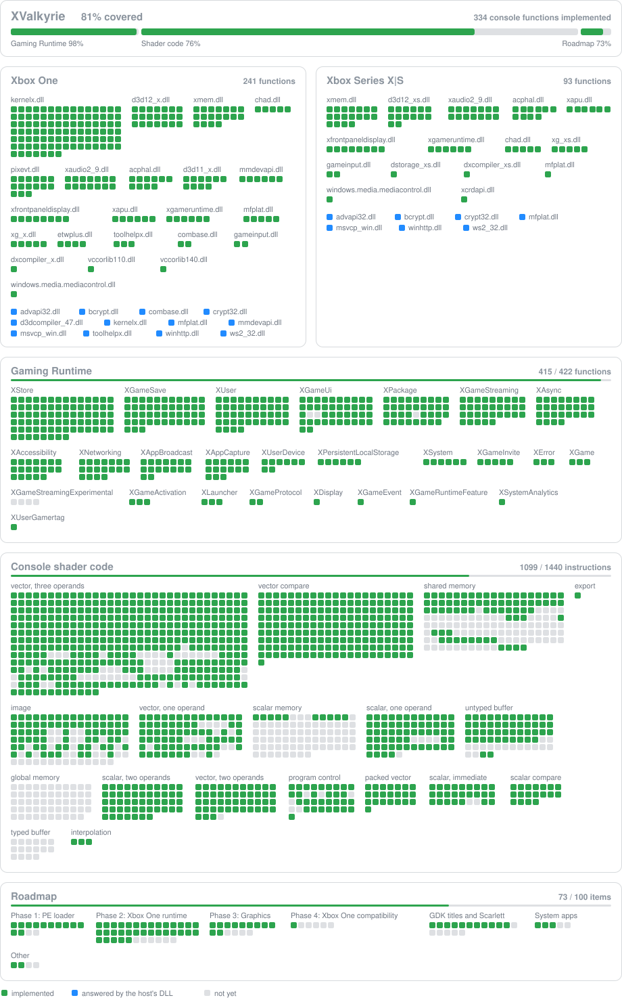

# Status

Written by `tools/status.py` from the tree and the built `xvboot`; do not edit. What each
number counts is at the top of that file.

## Console modules

A module is one a console title imports from. Functions with an implementation here
are listed; a module with a host is forwarded to the host's DLL of that name for
everything else.

### Xbox One

| Module | Functions | Data | Host |
|---|---|---|---|
| `acphal.dll` | 10 | 0 |  |
| `advapi32.dll` | 0 | 0 | advapi32.dll |
| `bcrypt.dll` | 0 | 0 | bcrypt.dll |
| `chad.dll` | 5 | 0 |  |
| `combase.dll` | 2 | 0 | combase.dll |
| `crypt32.dll` | 0 | 0 | crypt32.dll |
| `d3d11_x.dll` | 9 | 0 |  |
| `d3d12_x.dll` | 21 | 32 |  |
| `d3dcompiler_47.dll` | 0 | 0 | d3dcompiler_47.dll |
| `dxcompiler_x.dll` | 1 | 0 |  |
| `etwplus.dll` | 4 | 0 |  |
| `gameinput.dll` | 2 | 0 |  |
| `kernelx.dll` | 82 | 0 | kernel32.dll |
| `mfplat.dll` | 5 | 0 | mfplat.dll |
| `mmdevapi.dll` | 6 | 0 | mmdevapi.dll |
| `msvcp_win.dll` | 0 | 0 | msvcp_win.dll |
| `pixevt.dll` | 15 | 0 |  |
| `toolhelpx.dll` | 3 | 0 | kernel32.dll |
| `vccorlib110.dll` | 1 | 0 |  |
| `vccorlib140.dll` | 1 | 0 |  |
| `windows.media.mediacontrol.dll` | 1 | 0 |  |
| `winhttp.dll` | 0 | 0 | winhttp.dll |
| `ws2_32.dll` | 0 | 0 | ws2_32.dll |
| `xapu.dll` | 6 | 0 |  |
| `xaudio2_9.dll` | 14 | 0 |  |
| `xfrontpaneldisplay.dll` | 8 | 0 |  |
| `xg_x.dll` | 5 | 0 |  |
| `xgameruntime.dll` | 6 | 0 |  |
| `xmem.dll` | 18 | 0 |  |

45 functions of the host's API are answered the console's way, whichever API set a title imports them from:

`CoCreateInstance`, `CreateDirectoryW`, `CreateFile2`, `CreateFileA`, `CreateFileW`, `CreateWindowExA`, `CreateWindowExW`, `DeleteFileW`, `FindFirstFileA`, `FindFirstFileExA`, `FindFirstFileExW`, `FindFirstFileW`, `FreeLibrary`, `GetCurrentProcessorNumber`, `GetFileAttributesA`, `GetFileAttributesExA`, `GetFileAttributesExW`, `GetFileAttributesW`, `GetProcAddress`, `GetSystemInfo`, `LoadLibraryA`, `LoadLibraryExA`, `LoadLibraryExW`, `LoadLibraryW`, `LoadPackagedLibrary`, `MoveFileExW`, `OutputDebugStringA`, `OutputDebugStringW`, `ReadFile`, `ReadFileEx`, `RegCloseKey`, `RegOpenKeyExW`, `RegOpenKeyW`, `RegQueryValueExW`, `RemoveDirectoryW`, `SetFileAttributesW`, `SetThreadAffinityMask`, `SetThreadpoolAffinityMask`, `ShowWindow`, `VirtualAlloc`, `VirtualAllocEx`, `VirtualFree`, `VirtualFreeEx`, `VirtualProtect`, `__C_specific_handler`

<code>acphal.dll</code>: 10 functions

`AcpHalAllocateShapeContexts`, `AcpHalCreate`, `AcpHalReleaseShapeContexts`, `ApuAlloc`, `ApuCreateHeap`, `ApuFree`, `ApuHeapGetState`, `ApuIsVirtualAddressValid`, `ApuMapApuAddress`, `ApuMapVirtualAddress`

<code>chad.dll</code>: 5 functions

`XDspActivate`, `XDspConnect`, `XDspDeactivate`, `XDspDisconnect`, `XDspSubmitCommand`

<code>combase.dll</code>: 2 functions

`RoActivateInstance`, `RoGetActivationFactory`

<code>d3d11_x.dll</code>: 9 functions

`D3D11CreateDevice`, `D3D11XCreateDeviceX`, `D3DAllocateGraphicsMemory`, `D3DFreeGraphicsMemory`, `D3DMapEsramMemory`, `DXGIXGetFrameStatistics`, `DXGIXPresentArray`, `DXGIXSetFrameNotification`, `DXGIXSetVLineNotification`

<code>d3d12_x.dll</code>: 21 functions

`D3D12ConfigureVirtualMemoryX`, `D3D12CreateDevice`, `D3D12CreateRootSignatureDeserializer`, `D3D12CreateVersionedRootSignatureDeserializer`, `D3D12GetDebugInterface`, `D3D12SerializeRootSignature`, `D3D12SerializeVersionedRootSignature`, `D3D12XboxCreateDevice`, `D3D12XboxEnableMemoryProfiling`, `D3D12XboxGetProcessDebugFlags`, `D3D12XboxSetProcessDebugFlags`, `D3D12XboxUnloadDriverModule`, `D3DAllocateGraphicsMemory`, `D3DConfigureVirtualMemory`, `D3DFlushEntireCpuCache`, `D3DFreeGraphicsMemory`, `D3DMapEsramMemory`, `DXGIXGetFrameStatistics`, `DXGIXPresentArray`, `DXGIXSetFrameNotification`, `DXGIXSetVLineNotification`

<code>dxcompiler_x.dll</code>: 1 functions

`DxcCreateInstance`

<code>etwplus.dll</code>: 4 functions

`EtxEventWrite`, `EtxFillCommonFields_v7`, `EtxRegister`, `EtxUnregister`

<code>gameinput.dll</code>: 2 functions

`#1`, `GameInputCreate`

<code>kernelx.dll</code>: 82 functions

`AllocateTitlePhysicalPages`, `CreateDirectoryW`, `CreateFile2`, `CreateFileA`, `CreateFileW`, `DeleteFileW`, `EventActivityIdControl`, `EventEnabled`, `EventProviderEnabled`, `EventRegister`, `EventSetInformation`, `EventUnregister`, `EventWrite`, `EventWriteEx`, `EventWriteString`, `EventWriteTransfer`, `FindFirstFileA`, `FindFirstFileExA`, `FindFirstFileExW`, `FindFirstFileW`, `FreeLibrary`, `FreeTitlePhysicalPages`, `GetConsoleType`, `GetCurrentProcessorNumber`, `GetFileAttributesA`, `GetFileAttributesExA`, `GetFileAttributesExW`, `GetFileAttributesW`, `GetProcAddress`, `GetSystemInfo`, `GetSystemOSVersion`, `GetThreadName`, `GetTraceEnableFlags`, `GetTraceEnableLevel`, `GetTraceLoggerHandle`, `JobTitleMemoryStatus`, `LoadLibraryA`, `LoadLibraryExA`, `LoadLibraryExW`, `LoadLibraryW`, `LoadPackagedLibrary`, `MapTitlePhysicalPages`, `MoveFileExW`, `OutputDebugStringA`, `OutputDebugStringW`, `QueryProcessorSchedulingStatistics`, `ReadFile`, `ReadFileEx`, `RegisterTraceGuidsA`, `RegisterTraceGuidsW`, `RemoveDirectoryW`, `SetFileAttributesW`, `SetThreadAffinityMask`, `SetThreadName`, `SetThreadpoolAffinityMask`, `TitleMemoryStatus`, `ToolingMemoryStatus`, `TraceEvent`, `TraceEventInstance`, `TraceMessage`, `TraceMessageVa`, `UnregisterTraceGuids`, `VirtualAlloc`, `VirtualAllocEx`, `VirtualFree`, `VirtualFreeEx`, `VirtualProtect`, `WaitOnAddress`, `WakeByAddressAll`, `WakeByAddressSingle`, `XMemAlloc`, `XMemAllocDefault`, `XMemCheckDefaultHeaps`, `XMemFree`, `XMemFreeDefault`, `XMemGetAllocationHysteresis`, `XMemGetAllocationStatistics`, `XMemGetAuxiliaryTitleMemory`, `XMemPreallocateFreeSpace`, `XMemReleaseAuxiliaryTitleMemory`, `XMemSetAllocationHooks`, `XMemSetAllocationHysteresis`

<code>mfplat.dll</code>: 5 functions

`MFCreateDXGISurfaceBufferX`, `MFCreateDxvaSampleRendererX`, `MFCreateNV12ToRGB32ConverterX`, `MFCreateRGB32ToNV12ConverterX`, `MFResetDXGIDeviceManagerX`

<code>mmdevapi.dll</code>: 6 functions

`ActivateAudioInterfaceAsync`, `DisableBitstreamOut`, `EnableSpatialAudio`, `RefreshWasapiDeviceList`, `RestoreBitstreamOut`, `SetWasapiThreadAffinityMask`

<code>pixevt.dll</code>: 15 functions

`ConfigureL2IPMCs`, `ConfigureNBPMCs`, `ConfigurePMCs`, `GetCaptureControlState`, `PIXBeginCapture`, `PIXEndCapture`, `PIXEventsReplaceBlock`, `PIXGetCaptureState`, `PIXReportCounter`, `RegisterForCaptureControl`, `SetCaptureCallgraphState`, `SetCaptureFunctionDetailsState`, `SetCaptureFunctionSummaryState`, `SetCaptureInstructionTraceState`, `UnregisterForCaptureControl`

<code>toolhelpx.dll</code>: 3 functions

`GetSourceLineFromAddress`, `GetSymbolFromAddress`, `QuerySystemHardwareInfo`

<code>vccorlib110.dll</code>: 1 functions

`?GetActivationFactoryByPCWSTR@@YAJPEAXAEAVGuid@Platform@@PEAPEAX@Z`

<code>vccorlib140.dll</code>: 1 functions

`?GetActivationFactoryByPCWSTR@@YAJPEAXAEAVGuid@Platform@@PEAPEAX@Z`

<code>windows.media.mediacontrol.dll</code>: 1 functions

`CreateRenderAudioStateMonitorForCategoryAndDeviceRole`

<code>xapu.dll</code>: 6 functions

`XApuConnect`, `XApuDequeueResult`, `XApuDisconnect`, `XApuEnqueueCommand`, `XApuGetResultCount`, `XApuGetUtilization`

<code>xaudio2_9.dll</code>: 14 functions

`#1`, `#2`, `#3`, `#4`, `#5`, `#6`, `#7`, `CreateAudioReverb`, `CreateAudioReverbV2_8`, `CreateAudioVolumeMeter`, `CreateFX`, `X3DAudioCalculate`, `X3DAudioInitialize`, `XAudio2Create`

<code>xfrontpaneldisplay.dll</code>: 8 functions

`XFrontPanelGetButtonStates`, `XFrontPanelGetLightStates`, `XFrontPanelGetScreenDimensions`, `XFrontPanelGetScreenPixelFormat`, `XFrontPanelIsSupported`, `XFrontPanelPresentBuffer`, `XFrontPanelSetDisplayName`, `XFrontPanelSetLightStates`

<code>xg_x.dll</code>: 5 functions

`XGComputeOptimalDepthStencilTileModes`, `XGComputeOptimalTileMode`, `XGComputeTexture2DLayout`, `XGCreateTexture2DComputer`, `XGCreateTextureComputer`

<code>xgameruntime.dll</code>: 6 functions

`DllCanUnloadNow`, `InitializeApiImpl`, `InitializeApiImplEx`, `QueryApiImpl`, `UninitializeApiImpl`, `XErrorReport`

<code>xmem.dll</code>: 18 functions

`XMemAlloc`, `XMemAllocDefault`, `XMemAllocatePhysicalPages`, `XMemFree`, `XMemFreeDefault`, `XMemFreePhysicalPages`, `XMemGetAllocationHysteresis`, `XMemGetAllocationStatistics`, `XMemGetWin32HeapStatistics`, `XMemGetWorkingSetStatistics`, `XMemIsToolsMemAvailable`, `XMemMakeTag`, `XMemMapPhysicalPages`, `XMemPreallocateFreeSpace`, `XMemSetAllocationHooks`, `XMemSetAllocationHysteresis`, `XMemTransferMemory`, `XMemVirtualAlloc`

### Xbox Series X|S

| Module | Functions | Data | Host |
|---|---|---|---|
| `acphal.dll` | 10 | 0 |  |
| `advapi32.dll` | 0 | 0 | advapi32.dll |
| `bcrypt.dll` | 0 | 0 | bcrypt.dll |
| `chad.dll` | 5 | 0 |  |
| `crypt32.dll` | 0 | 0 | crypt32.dll |
| `d3d12_xs.dll` | 14 | 32 |  |
| `dstorage_xs.dll` | 1 | 0 |  |
| `dxcompiler_xs.dll` | 1 | 0 |  |
| `gameinput.dll` | 2 | 0 |  |
| `mfplat.dll` | 1 | 0 | mfplat.dll |
| `msvcp_win.dll` | 0 | 0 | msvcp_win.dll |
| `windows.media.mediacontrol.dll` | 1 | 0 |  |
| `winhttp.dll` | 0 | 0 | winhttp.dll |
| `ws2_32.dll` | 0 | 0 | ws2_32.dll |
| `xapu.dll` | 6 | 0 |  |
| `xaudio2_9.dll` | 14 | 0 |  |
| `xcrdapi.dll` | 1 | 0 |  |
| `xfrontpaneldisplay.dll` | 8 | 0 |  |
| `xg_xs.dll` | 5 | 0 |  |
| `xgameruntime.dll` | 6 | 0 |  |
| `xmem.dll` | 18 | 0 |  |

46 functions of the host's API are answered the console's way, whichever API set a title imports them from:

`CoCreateInstance`, `CreateDirectoryW`, `CreateFile2`, `CreateFileA`, `CreateFileW`, `CreateWindowExA`, `CreateWindowExW`, `DeleteFileW`, `FindFirstFileA`, `FindFirstFileExA`, `FindFirstFileExW`, `FindFirstFileW`, `FreeLibrary`, `GetCurrentProcessorNumber`, `GetFileAttributesA`, `GetFileAttributesExA`, `GetFileAttributesExW`, `GetFileAttributesW`, `GetProcAddress`, `GetSystemInfo`, `LoadLibraryA`, `LoadLibraryExA`, `LoadLibraryExW`, `LoadLibraryW`, `LoadPackagedLibrary`, `MoveFileExW`, `OutputDebugStringA`, `OutputDebugStringW`, `ReadFile`, `ReadFileEx`, `RegCloseKey`, `RegOpenKeyExW`, `RegOpenKeyW`, `RegQueryValueExW`, `RemoveDirectoryW`, `RtlPcToFileHeader`, `SetFileAttributesW`, `SetThreadAffinityMask`, `SetThreadpoolAffinityMask`, `ShowWindow`, `VirtualAlloc`, `VirtualAllocEx`, `VirtualFree`, `VirtualFreeEx`, `VirtualProtect`, `__C_specific_handler`

<code>acphal.dll</code>: 10 functions

`AcpHalAllocateShapeContexts`, `AcpHalCreate`, `AcpHalReleaseShapeContexts`, `ApuAlloc`, `ApuCreateHeap`, `ApuFree`, `ApuHeapGetState`, `ApuIsVirtualAddressValid`, `ApuMapApuAddress`, `ApuMapVirtualAddress`

<code>chad.dll</code>: 5 functions

`XDspActivate`, `XDspConnect`, `XDspDeactivate`, `XDspDisconnect`, `XDspSubmitCommand`

<code>d3d12_xs.dll</code>: 14 functions

`D3D12ConfigureVirtualMemoryX`, `D3D12CreateDevice`, `D3D12CreateRootSignatureDeserializer`, `D3D12CreateVersionedRootSignatureDeserializer`, `D3D12GetDebugInterface`, `D3D12SerializeRootSignature`, `D3D12SerializeVersionedRootSignature`, `D3D12XboxCreateDevice`, `D3D12XboxEnableMemoryProfiling`, `D3D12XboxGetProcessDebugFlags`, `D3D12XboxSetProcessDebugFlags`, `D3D12XboxUnloadDriverModule`, `D3DConfigureVirtualMemory`, `D3DFlushEntireCpuCache`

<code>dstorage_xs.dll</code>: 1 functions

`DStorageGetFactory`

<code>dxcompiler_xs.dll</code>: 1 functions

`DxcCreateInstance`

<code>gameinput.dll</code>: 2 functions

`#1`, `GameInputCreate`

<code>mfplat.dll</code>: 1 functions

`MFResetDXGIDeviceManagerX`

<code>windows.media.mediacontrol.dll</code>: 1 functions

`CreateRenderAudioStateMonitorForCategoryAndDeviceRole`

<code>xapu.dll</code>: 6 functions

`XApuConnect`, `XApuDequeueResult`, `XApuDisconnect`, `XApuEnqueueCommand`, `XApuGetResultCount`, `XApuGetUtilization`

<code>xaudio2_9.dll</code>: 14 functions

`#1`, `#2`, `#3`, `#4`, `#5`, `#6`, `#7`, `CreateAudioReverb`, `CreateAudioReverbV2_8`, `CreateAudioVolumeMeter`, `CreateFX`, `X3DAudioCalculate`, `X3DAudioInitialize`, `XAudio2Create`

<code>xcrdapi.dll</code>: 1 functions

`DStorageGetFactory`

<code>xfrontpaneldisplay.dll</code>: 8 functions

`XFrontPanelGetButtonStates`, `XFrontPanelGetLightStates`, `XFrontPanelGetScreenDimensions`, `XFrontPanelGetScreenPixelFormat`, `XFrontPanelIsSupported`, `XFrontPanelPresentBuffer`, `XFrontPanelSetDisplayName`, `XFrontPanelSetLightStates`

<code>xg_xs.dll</code>: 5 functions

`XGComputeOptimalDepthStencilTileModes`, `XGComputeOptimalTileMode`, `XGComputeTexture2DLayout`, `XGCreateTexture2DComputer`, `XGCreateTextureComputer`

<code>xgameruntime.dll</code>: 6 functions

`DllCanUnloadNow`, `InitializeApiImpl`, `InitializeApiImplEx`, `QueryApiImpl`, `UninitializeApiImpl`, `XErrorReport`

<code>xmem.dll</code>: 18 functions

`XMemAlloc`, `XMemAllocDefault`, `XMemAllocatePhysicalPages`, `XMemFree`, `XMemFreeDefault`, `XMemFreePhysicalPages`, `XMemGetAllocationHysteresis`, `XMemGetAllocationStatistics`, `XMemGetWin32HeapStatistics`, `XMemGetWorkingSetStatistics`, `XMemIsToolsMemAvailable`, `XMemMakeTag`, `XMemMapPhysicalPages`, `XMemPreallocateFreeSpace`, `XMemSetAllocationHooks`, `XMemSetAllocationHysteresis`, `XMemTransferMemory`, `XMemVirtualAlloc`

## Gaming Runtime

The functions of `xgameruntime.dll` whose place in its tables is known. One without an
implementation says so in the log when a title calls it, and fails.

| API | Implemented | Known |
|---|---|---|
| XUser | 35 | 44 |
| XUserGamertag | 1 | 1 |
| XDisplay | 1 | 1 |
| XGameInvite | 4 | 5 |
| XAsync | 28 | 28 |
| XGameStreaming | 3 | 32 |
| XGameStreamingExperimental | 0 | 4 |
| XStore | 0 | 78 |
| XAppBroadcast | 1 | 16 |
| XLauncher | 3 | 3 |
| XNetworking | 8 | 18 |
| XAccessibility | 0 | 19 |
| XGameSave | 30 | 47 |
| XUserDevice | 5 | 8 |
| XGameActivation | 2 | 3 |
| XGameRuntimeFeature | 1 | 1 |
| XError | 3 | 3 |
| XGameProtocol | 2 | 2 |
| XGame | 2 | 3 |
| XAppCapture | 0 | 15 |
| XPackage | 15 | 35 |
| XSystemAnalytics | 1 | 1 |
| XGameEvent | 1 | 1 |
| XGameUi | 0 | 42 |
| XSystem | 3 | 6 |
| XPersistentLocalStorage | 3 | 6 |

XUser: 9 not implemented

`XUserAddByIdWithUiAsync`, `XUserAddByIdWithUiResult`, `XUserPlatformRemoteConnectSetEventHandlers`, `XUserPlatformRemoteConnectCancelPrompt`, `XUserPlatformSpopPromptSetEventHandlers`, `XUserPlatformSpopPromptComplete`, `XUserIsSignOutPresent`, `XUserSignOutAsync`, `XUserSignOutResult`

XGameInvite: 1 not implemented

`XGameInviteAcceptPendingInvite`

XGameStreaming: 29 not implemented

`XGameStreamingRegisterClientPropertiesChanged`, `XGameStreamingUnregisterClientPropertiesChanged`, `XGameStreamingGetStreamPhysicalDimensions`, `XGameStreamingGetClientCount`, `XGameStreamingGetClients`, `XGameStreamingGetConnectionState`, `XGameStreamingRegisterConnectionStateChanged`, `XGameStreamingUnregisterConnectionStateChanged`, `XGameStreamingGetStreamAddedLatency`, `XGameStreamingGetServerLocationNameSize`, `XGameStreamingGetServerLocationName`, `XGameStreamingHideTouchControls`, `XGameStreamingShowTouchControlLayout`, `XGameStreamingHideTouchControlsOnClient`, `XGameStreamingShowTouchControlLayoutOnClient`, `XGameStreamingIsTouchInputEnabled`, `XGameStreamingGetLastFrameDisplayed`, `XGameStreamingGetAssociatedFrame`, `XGameStreamingGetGamepadPhysicality`, `XGameStreamingUpdateTouchControlsState`, `XGameStreamingUpdateTouchControlsStateOnClient`, `XGameStreamingShowTouchControlsWithStateUpdate`, `XGameStreamingShowTouchControlsWithStateUpdateOnClient`, `XGameStreamingGetTouchBundleVersionNameSize`, `XGameStreamingGetTouchBundleVersion`, `XGameStreamingGetClientIPAddress`, `XGameStreamingGetSessionId`, `XGameStreamingGetDisplayDetails`, `XGameStreamingSetResolution`

XGameStreamingExperimental: 4 not implemented

`EXPERIMENTAL_XGameStreamingGetClientOrientation`, `EXPERIMENTAL_XGameStreamingGetMotionState`, `EXPERIMENTAL_XGameStreamingGetMotionInfo`, `XGameStreamingSendDebugMessageToClient`

XStore: 78 not implemented

`XStoreCreateContext`, `XStoreCloseContextHandle`, `XStoreQueryAssociatedProductsAsync`, `XStoreQueryAssociatedProductsResult`, `XStoreQueryProductsAsync`, `XStoreQueryProductsResult`, `XStoreQueryEntitledProductsAsync`, `XStoreQueryEntitledProductsResult`, `XStoreQueryProductForCurrentGameAsync`, `XStoreQueryProductForCurrentGameResult`, `XStoreQueryProductForPackageAsync`, `XStoreQueryProductForPackageResult`, `XStoreEnumerateProductsQuery`, `XStoreProductsQueryHasMorePages`, `XStoreProductsQueryNextPageAsync`, `XStoreProductsQueryNextPageResult`, `XStoreCloseProductsQueryHandle`, `XStoreAcquireLicenseForPackageAsync`, `XStoreAcquireLicenseForPackageResult`, `XStoreIsLicenseValid`, `XStoreCloseLicenseHandle`, `XStoreCanAcquireLicenseForStoreIdAsync`, `XStoreCanAcquireLicenseForStoreIdResult`, `XStoreCanAcquireLicenseForPackageAsync`, `XStoreCanAcquireLicenseForPackageResult`, `XStoreQueryGameLicenseAsync`, `XStoreQueryGameLicenseResult`, `XStoreQueryAddOnLicensesAsync`, `XStoreQueryAddOnLicensesResultCount`, `XStoreQueryAddOnLicensesResult`, `XStoreQueryConsumableBalanceRemainingAsync`, `XStoreQueryConsumableBalanceRemainingResult`, `XStoreReportConsumableFulfillmentAsync`, `XStoreReportConsumableFulfillmentResult`, `XStoreGetUserCollectionsIdAsync`, `XStoreGetUserCollectionsIdResultSize`, `XStoreGetUserCollectionsIdResult`, `XStoreGetUserPurchaseIdAsync`, `XStoreGetUserPurchaseIdResultSize`, `XStoreGetUserPurchaseIdResult`, `XStoreQueryLicenseTokenAsync`, `XStoreQueryLicenseTokenResultSize`, `XStoreQueryLicenseTokenResult`, `XStoreShowPurchaseUIAsync`, `XStoreShowPurchaseUIResult`, `XStoreShowRateAndReviewUIAsync`, `XStoreShowRateAndReviewUIResult`, `XStoreShowRedeemTokenUIAsync`, `XStoreShowRedeemTokenUIResult`, `XStoreQueryGameAndDlcPackageUpdatesAsync`, `XStoreQueryGameAndDlcPackageUpdatesResultCount`, `XStoreQueryGameAndDlcPackageUpdatesResult`, `XStoreDownloadPackageUpdatesAsync`, `XStoreDownloadPackageUpdatesResult`, `XStoreDownloadAndInstallPackageUpdatesAsync`, `XStoreDownloadAndInstallPackageUpdatesResult`, `XStoreDownloadAndInstallPackagesAsync`, `XStoreDownloadAndInstallPackagesResultCount`, `XStoreDownloadAndInstallPackagesResult`, `XStoreQueryPackageIdentifier`, `XStoreRegisterGameLicenseChanged`, `XStoreUnregisterGameLicenseChanged`, `XStoreRegisterPackageLicenseLost`, `XStoreUnregisterPackageLicenseLost`, `XStoreIsAvailabilityPurchasable`, `XStoreAcquireLicenseForDurablesAsync`, `XStoreAcquireLicenseForDurablesResult`, `XStoreShowAssociatedProductsUIAsync`, `XStoreShowAssociatedProductsUIResult`, `XStoreShowProductPageUIAsync`, `XStoreShowProductPageUIResult`, `XStoreQueryAssociatedProductsForStoreIdAsync`, `XStoreQueryAssociatedProductsForStoreIdResult`, `XStoreQueryPackageUpdatesAsync`, `XStoreQueryPackageUpdatesResultCount`, `XStoreQueryPackageUpdatesResult`, `XStoreShowGiftingUIAsync`, `XStoreShowGiftingUIResult`

XAppBroadcast: 15 not implemented

`XAppBroadcastShowUI`, `XAppBroadcastGetStatus`, `XAppBroadcastRegisterIsAppBroadcastingChanged`, `XAppBroadcastUnregisterIsAppBroadcastingChanged`, `XAppCaptureMetadataAddStringEvent`, `XAppCaptureMetadataAddInt32Event`, `XAppCaptureMetadataAddDoubleEvent`, `XAppCaptureMetadataStartStringState`, `XAppCaptureMetadataStartInt32State`, `XAppCaptureMetadataStartDoubleState`, `XAppCaptureMetadataStopState`, `XAppCaptureMetadataStopAllStates`, `XAppCaptureMetadataRemainingStorageBytesAvailable`, `XAppCaptureRegisterMetadataPurged`, `XAppCaptureUnRegisterMetadataPurged`

XNetworking: 10 not implemented

`XNetworkingQuerySecurityInformationForUrlAsync`, `XNetworkingQuerySecurityInformationForUrlAsyncResultSize`, `XNetworkingQuerySecurityInformationForUrlAsyncResult`, `XNetworkingQuerySecurityInformationForUrlUtf16Async`, `XNetworkingQuerySecurityInformationForUrlUtf16AsyncResultSize`, `XNetworkingQuerySecurityInformationForUrlUtf16AsyncResult`, `XNetworkingVerifyServerCertificate`, `XNetworkingQueryConfigurationSetting`, `XNetworkingSetConfigurationSetting`, `XNetworkingQueryStatistics`

XAccessibility: 19 not implemented

`XClosedCaptionGetProperties`, `XClosedCaptionSetEnabled`, `XHighContrastGetMode`, `XSpeechToTextSetPositionHint`, `XSpeechToTextSendString`, `XSpeechSynthesizerEnumerateInstalledVoices`, `XSpeechSynthesizerCreate`, `XSpeechSynthesizerCloseHandle`, `XSpeechSynthesizerSetDefaultVoice`, `XSpeechSynthesizerSetCustomVoice`, `XSpeechSynthesizerCreateStreamFromText`, `XSpeechSynthesizerCloseStreamHandle`, `XSpeechSynthesizerGetStreamDataSize`, `XSpeechSynthesizerGetStreamData`, `XSpeechToTextBeginHypothesisString`, `XSpeechToTextUpdateHypothesisString`, `XSpeechToTextFinalizeHypothesisString`, `XSpeechToTextCancelHypothesisString`, `XSpeechSynthesizerCreateStreamFromSsml`

XGameSave: 17 not implemented

`PFXGameSaveInitializeConfig`, `PFXGameSaveFreeConfig`, `PFXGameSaveFilesGetFolderWithUiAsync`, `PFXGameSaveFilesGetFolderWithUiResult`, `PFXGameSaveFilesGetRemainingQuota`, `PFXGameSaveSetUiCallbacks`, `PFXGameSaveProgressUiGetProgress`, `PFXGameSaveSetProgressUiResponse`, `PFXGameSaveSetSyncFailedUiResponse`, `PFXGameSaveSetActiveDeviceContentionUiResponse`, `PFXGameSaveSetConflictUiResponse`, `PFXGameSaveSetOutOfStorageUiResponse`, `PFXGameSaveFilesUploadWithUiAsync`, `PFXGameSaveFilesUploadWithUiResult`, `PFXGameSaveFilesSetSaveDescriptionAsync`, `PFXGameSaveFilesSetSaveDescriptionResult`, `PFXGameSaveSetActiveDeviceChangedCallback`

XUserDevice: 3 not implemented

`XUserGetDefaultAudioEndpointUtf16`, `XUserFindControllerForUserWithUiAsync`, `XUserFindControllerForUserWithUiResult`

XGameActivation: 1 not implemented

`XGameActivationAcceptPendingInvite`

XGame: 1 not implemented

`XLaunchRestartOnCrash`

XAppCapture: 15 not implemented

`XAppCaptureTakeDiagnosticScreenshot`, `XAppCaptureRecordDiagnosticClip`, `XAppCaptureTakeScreenshot`, `XAppCaptureOpenScreenshotStream`, `XAppCaptureReadScreenshotStream`, `XAppCaptureCloseScreenshotStream`, `XAppCaptureEnableRecord`, `XAppCaptureDisableRecord`, `XAppCaptureGetVideoCaptureSettings`, `XAppCaptureRecordTimespan`, `XAppCaptureReadLocalStream`, `XAppCaptureCloseLocalStream`, `XAppCaptureStartUserRecord`, `XAppCaptureStopUserRecord`, `XAppCaptureCancelUserRecord`

XPackage: 20 not implemented

`XPackageCreateInstallationMonitor`, `XPackageCloseInstallationMonitorHandle`, `XPackageGetInstallationProgress`, `XPackageUpdateInstallationMonitor`, `XPackageRegisterInstallationProgressChanged`, `XPackageUnregisterInstallationProgressChanged`, `XPackageEnumerateChunkAvailability`, `XPackageChangeChunkInstallOrder`, `XPackageInstallChunks`, `XPackageInstallChunksAsync`, `XPackageInstallChunksResult`, `XPackageEstimateDownloadSize`, `XPackageUninstallChunks`, `XPackageGetIdentifier`, `XPackageGetWriteStats`, `XPackageUninstallUWPInstance`, `XPackageUninstallPackage`, `XPackageMountWithUiAsync`, `XPackageMountWithUiResult`, `XPackageGetPackageKind`

XGameUi: 42 not implemented

`XGameUiShowMessageDialogAsync`, `XGameUiShowMessageDialogResult`, `XGameUiShowSendGameInviteAsync`, `XGameUiShowSendGameInviteResult`, `XGameUiShowPlayerProfileCardAsync`, `XGameUiShowPlayerProfileCardResult`, `XGameUiShowAchievementsAsync`, `XGameUiShowAchievementsResult`, `XGameUiShowPlayerPickerAsync`, `XGameUiShowPlayerPickerResultCount`, `XGameUiShowPlayerPickerResult`, `XGameUiShowErrorDialogAsync`, `XGameUiShowErrorDialogResult`, `XGameUiSetNotificationPositionHint`, `XGameUiShowTextEntryAsync`, `XGameUiShowTextEntryResultSize`, `XGameUiShowTextEntryResult`, `XGameUiShowWebAuthenticationAsync`, `XGameUiShowWebAuthenticationResultSize`, `XGameUiShowWebAuthenticationResult`, `XGameUiShowWebAuthenticationWithOptionsAsync`, `XGameUiShowManageSpaceAsync`, `XGameUiShowManageSpaceResult`, `XGameUiShowMultiplayerActivityGameInviteAsync`, `XGameUiShowMultiplayerActivityGameInviteResult`, `XGameUiTextEntryOpen`, `XGameUiTextEntryClose`, `XGameUiTextEntryGetState`, `XGameUiTextEntryGetExtents`, `XGameUiTextEntryUpdatePositionHint`, `XGameUiTextEntryUpdateVisibility`, `XGameUiShowStateShareAsync`, `XGameUiShowStateShareResult`, `XGameUiSetUiCallbacks`, `XGameUiSetMessageDialogUiResponse`, `XGameUiSetPlayerPickerUiResponse`, `XGameUiSetTextEntryUiResponse`, `XGameUiSetPlayerProfileCardUiResponse`, `XGameUiSetSendGameInviteUiResponse`, `XGameUiSetAchievementsUiResponse`, `XGameUiSetMultiplayerActivityGameInviteUiResponse`, `XGameUiSetErrorDialogUiResponse`

XSystem: 3 not implemented

`XSystemHandleTrack`, `XSystemIsHandleValid`, `XSystemAllowFullDownloadBandwidth`

XPersistentLocalStorage: 3 not implemented

`XPersistentLocalStoragePromptUserForSpaceAsync`, `XPersistentLocalStoragePromptUserForSpaceResult`, `XPersistentLocalStorageMountForPackage`

## Console shader code

Shaders of Series titles are machine code for the console's GPU, translated to HLSL.
An instruction counts when the translator has something for it; a shader is only
translated when all of its instructions do, and its resources are followed.

| Format | Handled | Known |
|---|---|---|
| scalar, two operands | 46 | 51 |
| scalar, immediate | 20 | 27 |
| scalar, one operand | 38 | 65 |
| scalar compare | 16 | 18 |
| program control | 14 | 37 |
| scalar memory | 10 | 78 |
| vector, two operands | 44 | 48 |
| vector, one operand | 39 | 81 |
| vector compare | 100 | 190 |
| vector, three operands | 219 | 428 |
| packed vector | 8 | 22 |
| interpolation | 3 | 3 |
| shared memory | 0 | 147 |
| global memory | 0 | 54 |
| untyped buffer | 38 | 64 |
| typed buffer | 0 | 16 |
| image | 65 | 110 |
| export | 1 | 1 |

scalar, two operands: 5 not handled

`s_subb_u32`, `s_bfe_u64`, `s_bfe_i64`, `s_absdiff_i32`, `s_pack_lh_b32_b16`

scalar, immediate: 7 not handled

`s_cmovk_i32`, `s_waitcnt_vscnt`, `s_waitcnt_vmcnt`, `s_waitcnt_expcnt`, `s_waitcnt_lgkmcnt`, `s_subvector_loop_begin`, `s_subvector_loop_end`

scalar, one operand: 27 not handled

`s_cmov_b64`, `s_wqm_b32`, `s_brev_b64`, `s_bcnt0_i32_b32`, `s_bcnt0_i32_b64`, `s_ff0_i32_b32`, `s_ff0_i32_b64`, `s_ff1_i32_b64`, `s_flbit_i32_b64`, `s_flbit_i32`, `s_flbit_i32_i64`, `s_xnor_saveexec_b64`, `s_quadmask_b32`, `s_quadmask_b64`, `s_movrels_b32`, `s_movrels_b64`, `s_movreld_b32`, `s_movreld_b64`, `s_orn1_saveexec_b64`, `s_andn1_wrexec_b64`, `s_andn2_wrexec_b64`, `s_bitreplicate_b64_b32`, `s_xnor_saveexec_b32`, `s_orn1_saveexec_b32`, `s_andn1_wrexec_b32`, `s_andn2_wrexec_b32`, `s_movrelsd_2_b32`

scalar compare: 2 not handled

`s_bitcmp0_b64`, `s_bitcmp1_b64`

program control: 23 not handled

`s_wakeup`, `s_setkill`, `s_sethalt`, `s_sleep`, `s_setprio`, `s_sendmsghalt`, `s_trap`, `s_icache_inv`, `s_incperflevel`, `s_decperflevel`, `s_ttracedata`, `s_cbranch_cdbgsys`, `s_cbranch_cdbguser`, `s_cbranch_cdbgsys_or_user`, `s_cbranch_cdbgsys_and_user`, `s_endpgm_saved`, `s_endpgm_ordered_ps_done`, `s_clause`, `s_wait_idle`, `s_waitcnt_depctr`, `s_round_mode`, `s_denorm_mode`, `s_ttracedata_imm`

scalar memory: 68 not handled

`s_scratch_load_dword`, `s_scratch_load_dwordx2`, `s_scratch_load_dwordx4`, `s_store_dword`, `s_store_dwordx2`, `s_store_dwordx4`, `s_scratch_store_dword`, `s_scratch_store_dwordx2`, `s_scratch_store_dwordx4`, `s_buffer_store_dword`, `s_buffer_store_dwordx2`, `s_buffer_store_dwordx4`, `s_atc_probe`, `s_atc_probe_buffer`, `s_dcache_discard`, `s_dcache_discard_x2`, `s_buffer_atomic_swap`, `s_buffer_atomic_cmpswap`, `s_buffer_atomic_add`, `s_buffer_atomic_sub`, `s_buffer_atomic_smin`, `s_buffer_atomic_umin`, `s_buffer_atomic_smax`, `s_buffer_atomic_umax`, `s_buffer_atomic_and`, `s_buffer_atomic_or`, `s_buffer_atomic_xor`, `s_buffer_atomic_inc`, `s_buffer_atomic_dec`, `s_buffer_atomic_swap_x2`, `s_buffer_atomic_cmpswap_x2`, `s_buffer_atomic_add_x2`, `s_buffer_atomic_sub_x2`, `s_buffer_atomic_smin_x2`, `s_buffer_atomic_umin_x2`, `s_buffer_atomic_smax_x2`, `s_buffer_atomic_umax_x2`, `s_buffer_atomic_and_x2`, `s_buffer_atomic_or_x2`, `s_buffer_atomic_xor_x2`, `s_buffer_atomic_inc_x2`, `s_buffer_atomic_dec_x2`, `s_atomic_swap`, `s_atomic_cmpswap`, `s_atomic_add`, `s_atomic_sub`, `s_atomic_smin`, `s_atomic_umin`, `s_atomic_smax`, `s_atomic_umax`, `s_atomic_and`, `s_atomic_or`, `s_atomic_xor`, `s_atomic_inc`, `s_atomic_dec`, `s_atomic_swap_x2`, `s_atomic_cmpswap_x2`, `s_atomic_add_x2`, `s_atomic_sub_x2`, `s_atomic_smin_x2`, `s_atomic_umin_x2`, `s_atomic_smax_x2`, `s_atomic_umax_x2`, `s_atomic_and_x2`, `s_atomic_or_x2`, `s_atomic_xor_x2`, `s_atomic_inc_x2`, `s_atomic_dec_x2`

vector, two operands: 4 not handled

`v_subrev_co_ci_u32`, `v_fmamk_f16`, `v_ldexp_f16`, `v_pk_fmac_f16`

vector, one operand: 42 not handled

`v_cvt_i32_f64`, `v_cvt_f64_i32`, `v_cvt_f32_f64`, `v_cvt_f64_f32`, `v_cvt_u32_f64`, `v_cvt_f64_u32`, `v_trunc_f64`, `v_ceil_f64`, `v_rndne_f64`, `v_floor_f64`, `v_pipeflush`, `v_rcp_f64`, `v_rsq_f64`, `v_sqrt_f64`, `v_ffbh_i32`, `v_frexp_exp_i32_f64`, `v_frexp_mant_f64`, `v_fract_f64`, `v_frexp_exp_i32_f32`, `v_frexp_mant_f32`, `v_clrexcp`, `v_movreld_b32`, `v_movrels_b32`, `v_movrelsd_b32`, `v_movrelsd_2_b32`, `v_cvt_f16_u16`, `v_cvt_f16_i16`, `v_cvt_u16_f16`, `v_cvt_i16_f16`, `v_log_f16`, `v_exp_f16`, `v_frexp_mant_f16`, `v_frexp_exp_i16_f16`, `v_trunc_f16`, `v_rndne_f16`, `v_fract_f16`, `v_sin_f16`, `v_cos_f16`, `v_sat_pk_u8_i16`, `v_cvt_norm_i16_f16`, `v_cvt_norm_u16_f16`, `v_swaprel_b32`

vector compare: 90 not handled

`v_cmp_f_f64`, `v_cmp_lt_f64`, `v_cmp_eq_f64`, `v_cmp_le_f64`, `v_cmp_gt_f64`, `v_cmp_lg_f64`, `v_cmp_ge_f64`, `v_cmp_o_f64`, `v_cmp_u_f64`, `v_cmp_nge_f64`, `v_cmp_nlg_f64`, `v_cmp_ngt_f64`, `v_cmp_nle_f64`, `v_cmp_neq_f64`, `v_cmp_nlt_f64`, `v_cmp_tru_f64`, `v_cmpx_f_f64`, `v_cmpx_lt_f64`, `v_cmpx_eq_f64`, `v_cmpx_le_f64`, `v_cmpx_gt_f64`, `v_cmpx_lg_f64`, `v_cmpx_ge_f64`, `v_cmpx_o_f64`, `v_cmpx_u_f64`, `v_cmpx_nge_f64`, `v_cmpx_nlg_f64`, `v_cmpx_ngt_f64`, `v_cmpx_nle_f64`, `v_cmpx_neq_f64`, `v_cmpx_nlt_f64`, `v_cmpx_tru_f64`, `v_cmp_lt_i16`, `v_cmp_eq_i16`, `v_cmp_le_i16`, `v_cmp_gt_i16`, `v_cmp_ne_i16`, `v_cmp_ge_i16`, `v_cmpx_lt_i16`, `v_cmpx_eq_i16`, `v_cmpx_le_i16`, `v_cmpx_gt_i16`, `v_cmpx_ne_i16`, `v_cmpx_ge_i16`, `v_cmp_f_i64`, `v_cmp_lt_i64`, `v_cmp_eq_i64`, `v_cmp_le_i64`, `v_cmp_gt_i64`, `v_cmp_ne_i64`, `v_cmp_ge_i64`, `v_cmp_t_i64`, `v_cmp_class_f64`, `v_cmp_lt_u16`, `v_cmp_eq_u16`, `v_cmp_le_u16`, `v_cmp_gt_u16`, `v_cmp_ne_u16`, `v_cmp_ge_u16`, `v_cmpx_f_i64`, `v_cmpx_lt_i64`, `v_cmpx_eq_i64`, `v_cmpx_le_i64`, `v_cmpx_gt_i64`, `v_cmpx_ne_i64`, `v_cmpx_ge_i64`, `v_cmpx_t_i64`, `v_cmpx_class_f64`, `v_cmpx_lt_u16`, `v_cmpx_eq_u16`, `v_cmpx_le_u16`, `v_cmpx_gt_u16`, `v_cmpx_ne_u16`, `v_cmpx_ge_u16`, `v_cmp_f_u64`, `v_cmp_lt_u64`, `v_cmp_eq_u64`, `v_cmp_le_u64`, `v_cmp_gt_u64`, `v_cmp_ne_u64`, `v_cmp_ge_u64`, `v_cmp_t_u64`, `v_cmpx_f_u64`, `v_cmpx_lt_u64`, `v_cmpx_eq_u64`, `v_cmpx_le_u64`, `v_cmpx_gt_u64`, `v_cmpx_ne_u64`, `v_cmpx_ge_u64`, `v_cmpx_t_u64`

vector, three operands: 209 not handled

`v_cmp_f_f64`, `v_cmp_lt_f64`, `v_cmp_eq_f64`, `v_cmp_le_f64`, `v_cmp_gt_f64`, `v_cmp_lg_f64`, `v_cmp_ge_f64`, `v_cmp_o_f64`, `v_cmp_u_f64`, `v_cmp_nge_f64`, `v_cmp_nlg_f64`, `v_cmp_ngt_f64`, `v_cmp_nle_f64`, `v_cmp_neq_f64`, `v_cmp_nlt_f64`, `v_cmp_tru_f64`, `v_cmpx_f_f64`, `v_cmpx_lt_f64`, `v_cmpx_eq_f64`, `v_cmpx_le_f64`, `v_cmpx_gt_f64`, `v_cmpx_lg_f64`, `v_cmpx_ge_f64`, `v_cmpx_o_f64`, `v_cmpx_u_f64`, `v_cmpx_nge_f64`, `v_cmpx_nlg_f64`, `v_cmpx_ngt_f64`, `v_cmpx_nle_f64`, `v_cmpx_neq_f64`, `v_cmpx_nlt_f64`, `v_cmpx_tru_f64`, `v_cmp_lt_i16`, `v_cmp_eq_i16`, `v_cmp_le_i16`, `v_cmp_gt_i16`, `v_cmp_ne_i16`, `v_cmp_ge_i16`, `v_cmpx_lt_i16`, `v_cmpx_eq_i16`, `v_cmpx_le_i16`, `v_cmpx_gt_i16`, `v_cmpx_ne_i16`, `v_cmpx_ge_i16`, `v_cmp_f_i64`, `v_cmp_lt_i64`, `v_cmp_eq_i64`, `v_cmp_le_i64`, `v_cmp_gt_i64`, `v_cmp_ne_i64`, `v_cmp_ge_i64`, `v_cmp_t_i64`, `v_cmp_class_f64`, `v_cmp_lt_u16`, `v_cmp_eq_u16`, `v_cmp_le_u16`, `v_cmp_gt_u16`, `v_cmp_ne_u16`, `v_cmp_ge_u16`, `v_cmpx_f_i64`, `v_cmpx_lt_i64`, `v_cmpx_eq_i64`, `v_cmpx_le_i64`, `v_cmpx_gt_i64`, `v_cmpx_ne_i64`, `v_cmpx_ge_i64`, `v_cmpx_t_i64`, `v_cmpx_class_f64`, `v_cmpx_lt_u16`, `v_cmpx_eq_u16`, `v_cmpx_le_u16`, `v_cmpx_gt_u16`, `v_cmpx_ne_u16`, `v_cmpx_ge_u16`, `v_cmp_f_u64`, `v_cmp_lt_u64`, `v_cmp_eq_u64`, `v_cmp_le_u64`, `v_cmp_gt_u64`, `v_cmp_ne_u64`, `v_cmp_ge_u64`, `v_cmp_t_u64`, `v_cmpx_f_u64`, `v_cmpx_lt_u64`, `v_cmpx_eq_u64`, `v_cmpx_le_u64`, `v_cmpx_gt_u64`, `v_cmpx_ne_u64`, `v_cmpx_ge_u64`, `v_cmpx_t_u64`, `v_ldexp_f16`, `v_fma_f64`, `v_lerp_u8`, `v_alignbit_b32`, `v_alignbyte_b32`, `v_mullit_f32`, `v_sad_u8`, `v_sad_hi_u8`, `v_sad_u16`, `v_sad_u32`, `v_cvt_pk_u8_f32`, `v_div_fixup_f32`, `v_div_fixup_f64`, `v_add_f64`, `v_mul_f64`, `v_min_f64`, `v_max_f64`, `v_ldexp_f64`, `v_div_scale_f32`, `v_div_scale_f64`, `v_div_fmas_f32`, `v_div_fmas_f64`, `v_msad_u8`, `v_qsad_pk_u16_u8`, `v_mqsad_pk_u16_u8`, `v_trig_preop_f64`, `v_mqsad_u32_u8`, `v_mad_u64_u32`, `v_mad_i64_i32`, `v_cvt_i32_f64`, `v_cvt_f64_i32`, `v_cvt_f32_f64`, `v_cvt_f64_f32`, `v_cvt_u32_f64`, `v_cvt_f64_u32`, `v_trunc_f64`, `v_ceil_f64`, `v_rndne_f64`, `v_floor_f64`, `v_pipeflush`, `v_rcp_f64`, `v_rsq_f64`, `v_sqrt_f64`, `v_ffbh_i32`, `v_frexp_exp_i32_f64`, `v_frexp_mant_f64`, `v_fract_f64`, `v_frexp_exp_i32_f32`, `v_frexp_mant_f32`, `v_clrexcp`, `v_movreld_b32`, `v_movrels_b32`, `v_movrelsd_b32`, `v_movrelsd_2_b32`, `v_cvt_f16_u16`, `v_cvt_f16_i16`, `v_cvt_u16_f16`, `v_cvt_i16_f16`, `v_log_f16`, `v_exp_f16`, `v_frexp_mant_f16`, `v_frexp_exp_i16_f16`, `v_trunc_f16`, `v_rndne_f16`, `v_fract_f16`, `v_sin_f16`, `v_cos_f16`, `v_sat_pk_u8_i16`, `v_cvt_norm_i16_f16`, `v_cvt_norm_u16_f16`, `v_interp_p1_f32`, `v_interp_p2_f32`, `v_interp_mov_f32`, `v_lshlrev_b64`, `v_lshrrev_b64`, `v_ashrrev_i64`, `v_add_nc_u16`, `v_sub_nc_u16`, `v_mul_lo_u16`, `v_lshrrev_b16`, `v_ashrrev_i16`, `v_max_u16`, `v_max_i16`, `v_min_u16`, `v_min_i16`, `v_add_nc_i16`, `v_sub_nc_i16`, `v_pack_b32_f16`, `v_cvt_pknorm_i16_f16`, `v_cvt_pknorm_u16_f16`, `v_lshlrev_b16`, `v_mad_u16`, `v_interp_p1ll_f16`, `v_interp_p1lv_f16`, `v_perm_b32`, `v_min3_i16`, `v_min3_u16`, `v_max3_i16`, `v_max3_u16`, `v_med3_i16`, `v_med3_u16`, `v_interp_p2_f16`, `v_mad_i16`, `v_div_fixup_f16`, `v_writelane_b32`, `v_bfm_b32`, `v_bcnt_u32_b32`, `v_mbcnt_lo_u32_b32`, `v_mbcnt_hi_u32_b32`, `v_cvt_pknorm_i16_f32`, `v_cvt_pknorm_u16_f32`, `v_cvt_pk_u16_u32`, `v_cvt_pk_i16_i32`, `v_mad_u32_u16`, `v_mad_i32_i16`, `v_sub_nc_i32`, `v_permlane16_b32`, `v_permlanex16_b32`, `v_add_nc_i32`

packed vector: 14 not handled

`v_pk_mad_i16`, `v_pk_mul_lo_u16`, `v_pk_add_i16`, `v_pk_sub_i16`, `v_pk_lshlrev_b16`, `v_pk_lshrrev_b16`, `v_pk_ashrrev_i16`, `v_pk_max_i16`, `v_pk_min_i16`, `v_pk_mad_u16`, `v_pk_add_u16`, `v_pk_sub_u16`, `v_pk_max_u16`, `v_pk_min_u16`

shared memory: 147 not handled

`ds_add_u32`, `ds_sub_u32`, `ds_rsub_u32`, `ds_inc_u32`, `ds_dec_u32`, `ds_min_i32`, `ds_max_i32`, `ds_min_u32`, `ds_max_u32`, `ds_and_b32`, `ds_or_b32`, `ds_xor_b32`, `ds_mskor_b32`, `ds_write_b32`, `ds_write2_b32`, `ds_write2st64_b32`, `ds_cmpst_b32`, `ds_cmpst_f32`, `ds_min_f32`, `ds_max_f32`, `ds_nop`, `ds_add_f32`, `ds_write_b8`, `ds_write_b16`, `ds_add_rtn_u32`, `ds_sub_rtn_u32`, `ds_rsub_rtn_u32`, `ds_inc_rtn_u32`, `ds_dec_rtn_u32`, `ds_min_rtn_i32`, `ds_max_rtn_i32`, `ds_min_rtn_u32`, `ds_max_rtn_u32`, `ds_and_rtn_b32`, `ds_or_rtn_b32`, `ds_xor_rtn_b32`, `ds_mskor_rtn_b32`, `ds_wrxchg_rtn_b32`, `ds_wrxchg2_rtn_b32`, `ds_wrxchg2st64_rtn_b32`, `ds_cmpst_rtn_b32`, `ds_cmpst_rtn_f32`, `ds_min_rtn_f32`, `ds_max_rtn_f32`, `ds_wrap_rtn_b32`, `ds_swizzle_b32`, `ds_read_b32`, `ds_read2_b32`, `ds_read2st64_b32`, `ds_read_i8`, `ds_read_u8`, `ds_read_i16`, `ds_read_u16`, `ds_consume`, `ds_append`, `ds_add_u64`, `ds_sub_u64`, `ds_rsub_u64`, `ds_inc_u64`, `ds_dec_u64`, `ds_min_i64`, `ds_max_i64`, `ds_min_u64`, `ds_max_u64`, `ds_and_b64`, `ds_or_b64`, `ds_xor_b64`, `ds_mskor_b64`, `ds_write_b64`, `ds_write2_b64`, `ds_write2st64_b64`, `ds_cmpst_b64`, `ds_cmpst_f64`, `ds_min_f64`, `ds_max_f64`, `ds_add_rtn_f32`, `ds_add_rtn_u64`, `ds_sub_rtn_u64`, `ds_rsub_rtn_u64`, `ds_inc_rtn_u64`, `ds_dec_rtn_u64`, `ds_min_rtn_i64`, `ds_max_rtn_i64`, `ds_min_rtn_u64`, `ds_max_rtn_u64`, `ds_and_rtn_b64`, `ds_or_rtn_b64`, `ds_xor_rtn_b64`, `ds_mskor_rtn_b64`, `ds_wrxchg_rtn_b64`, `ds_wrxchg2_rtn_b64`, `ds_wrxchg2st64_rtn_b64`, `ds_cmpst_rtn_b64`, `ds_cmpst_rtn_f64`, `ds_min_rtn_f64`, `ds_max_rtn_f64`, `ds_read_b64`, `ds_read2_b64`, `ds_read2st64_b64`, `ds_condxchg32_rtn_b64`, `ds_add_src2_u32`, `ds_sub_src2_u32`, `ds_rsub_src2_u32`, `ds_inc_src2_u32`, `ds_dec_src2_u32`, `ds_min_src2_i32`, `ds_max_src2_i32`, `ds_min_src2_u32`, `ds_max_src2_u32`, `ds_and_src2_b32`, `ds_or_src2_b32`, `ds_xor_src2_b32`, `ds_write_src2_b32`, `ds_min_src2_f32`, `ds_max_src2_f32`, `ds_add_src2_f32`, `ds_write_b8_d16_hi`, `ds_write_b16_d16_hi`, `ds_read_u8_d16`, `ds_read_u8_d16_hi`, `ds_read_i8_d16`, `ds_read_i8_d16_hi`, `ds_read_u16_d16`, `ds_read_u16_d16_hi`, `ds_write_addtid_b32`, `ds_read_addtid_b32`, `ds_permute_b32`, `ds_bpermute_b32`, `ds_add_src2_u64`, `ds_sub_src2_u64`, `ds_rsub_src2_u64`, `ds_inc_src2_u64`, `ds_dec_src2_u64`, `ds_min_src2_i64`, `ds_max_src2_i64`, `ds_min_src2_u64`, `ds_max_src2_u64`, `ds_and_src2_b64`, `ds_or_src2_b64`, `ds_xor_src2_b64`, `ds_write_src2_b64`, `ds_min_src2_f64`, `ds_max_src2_f64`, `ds_write_b96`, `ds_write_b128`, `ds_read_b96`, `ds_read_b128`

global memory: 54 not handled

`global_load_ubyte`, `global_load_sbyte`, `global_load_ushort`, `global_load_sshort`, `global_load_dword`, `global_load_dwordx2`, `global_load_dwordx4`, `global_load_dwordx3`, `global_store_byte`, `global_store_byte_d16_hi`, `global_store_short`, `global_store_short_d16_hi`, `global_store_dword`, `global_store_dwordx2`, `global_store_dwordx4`, `global_store_dwordx3`, `global_load_ubyte_d16`, `global_load_ubyte_d16_hi`, `global_load_sbyte_d16`, `global_load_sbyte_d16_hi`, `global_load_short_d16`, `global_load_short_d16_hi`, `global_atomic_swap`, `global_atomic_cmpswap`, `global_atomic_add`, `global_atomic_sub`, `global_atomic_smin`, `global_atomic_umin`, `global_atomic_smax`, `global_atomic_umax`, `global_atomic_and`, `global_atomic_or`, `global_atomic_xor`, `global_atomic_inc`, `global_atomic_dec`, `global_atomic_fcmpswap`, `global_atomic_fmin`, `global_atomic_fmax`, `global_atomic_swap_x2`, `global_atomic_cmpswap_x2`, `global_atomic_add_x2`, `global_atomic_sub_x2`, `global_atomic_smin_x2`, `global_atomic_umin_x2`, `global_atomic_smax_x2`, `global_atomic_umax_x2`, `global_atomic_and_x2`, `global_atomic_or_x2`, `global_atomic_xor_x2`, `global_atomic_inc_x2`, `global_atomic_dec_x2`, `global_atomic_fcmpswap_x2`, `global_atomic_fmin_x2`, `global_atomic_fmax_x2`

untyped buffer: 26 not handled

`buffer_store_byte`, `buffer_store_byte_d16_hi`, `buffer_store_short`, `buffer_store_short_d16_hi`, `buffer_load_ubyte_d16`, `buffer_load_ubyte_d16_hi`, `buffer_load_sbyte_d16`, `buffer_load_sbyte_d16_hi`, `buffer_load_short_d16`, `buffer_load_short_d16_hi`, `buffer_atomic_swap_x2`, `buffer_atomic_cmpswap_x2`, `buffer_atomic_add_x2`, `buffer_atomic_sub_x2`, `buffer_atomic_smin_x2`, `buffer_atomic_umin_x2`, `buffer_atomic_smax_x2`, `buffer_atomic_umax_x2`, `buffer_atomic_and_x2`, `buffer_atomic_or_x2`, `buffer_atomic_xor_x2`, `buffer_atomic_inc_x2`, `buffer_atomic_dec_x2`, `buffer_atomic_fcmpswap_x2`, `buffer_atomic_fmin_x2`, `buffer_atomic_fmax_x2`

typed buffer: 16 not handled

`tbuffer_load_format_x`, `tbuffer_load_format_xy`, `tbuffer_load_format_xyz`, `tbuffer_load_format_xyzw`, `tbuffer_store_format_x`, `tbuffer_store_format_xy`, `tbuffer_store_format_xyz`, `tbuffer_store_format_xyzw`, `tbuffer_load_format_d16_x`, `tbuffer_load_format_d16_xy`, `tbuffer_load_format_d16_xyz`, `tbuffer_load_format_d16_xyzw`, `tbuffer_store_format_d16_x`, `tbuffer_store_format_d16_xy`, `tbuffer_store_format_d16_xyz`, `tbuffer_store_format_d16_xyzw`

image: 45 not handled

`image_sample_cl`, `image_sample_d_cl`, `image_sample_b_cl`, `image_sample_c`, `image_sample_c_cl`, `image_sample_c_d`, `image_sample_c_d_cl`, `image_sample_c_b`, `image_sample_c_b_cl`, `image_sample_cl_o`, `image_sample_d_cl_o`, `image_sample_b_cl_o`, `image_sample_c_o`, `image_sample_c_cl_o`, `image_sample_c_d_o`, `image_sample_c_d_cl_o`, `image_sample_c_b_o`, `image_sample_c_b_cl_o`, `image_gather4_cl`, `image_gather4_b_cl`, `image_gather4_c_cl`, `image_gather4_c_b_cl`, `image_gather4_cl_o`, `image_gather4_b_cl_o`, `image_gather4_c_cl_o`, `image_gather4_c_b_cl_o`, `image_get_lod`, `image_sample_cd_cl`, `image_sample_c_cd`, `image_sample_c_cd_cl`, `image_sample_cd_cl_o`, `image_sample_c_cd_o`, `image_sample_c_cd_cl_o`, `image_sample_d_cl_g16`, `image_sample_c_d_g16`, `image_sample_c_d_cl_g16`, `image_sample_d_cl_o_g16`, `image_sample_c_d_o_g16`, `image_sample_c_d_cl_o_g16`, `image_sample_cd_cl_g16`, `image_sample_c_cd_g16`, `image_sample_c_cd_cl_g16`, `image_sample_cd_cl_o_g16`, `image_sample_c_cd_o_g16`, `image_sample_c_cd_cl_o_g16`

